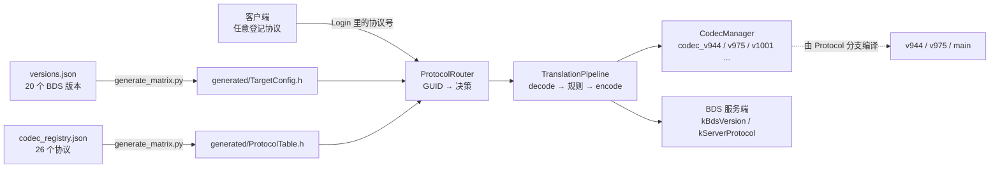

# CrossVersion — LeviLamina 单插件跨版本协议路由

[](https://github.com/alone8199/levilamina-crossversion/actions/workflows/build.yml)
[-blue.svg)](https://github.com/SculkCatalystMC/Protocol)

面向 Minecraft 基岩版服务端的**单插件跨版本框架**：按 BDS 版本分别构建，1.21.30 ~ 1.26.60 共 20 个独立产物，每个产物内置覆盖全部登记协议的路由表。协议差异不写进插件本体，而是放到运行时按协议号动态加载的 `codec_v*.dll` 里 —— 就是基岩版的 ViaVersion 思路。

> **先读这一段**：GitHub Actions 产出的 DLL 是 **standalone 构建**，能编译、能链接、能加载、能跑自测，但**不接管 BDS 网络**，因此不能让不同版本客户端直接进服。要真正接管网络，需要补齐逐版本的 hook 符号与翻译规则，走 `xmake.lua` 真机路径。这不是 CI 配置问题，而是 BDS 内部符号必须逐版本逆向。详见[第 2 节](#2-两条构建路径)与[第 6 节](#6-覆盖度什么能用什么要补)。

---

## 1. 怎么做的

### 调研结论

| 仓库 | 实际情况 | 能不能改 |
| --- | --- | --- |
| [GlacieTeam/Glacie](https://github.com/GlacieTeam/Glacie) | 闭源宿主插件，仓库只有 README / `tooth.json` / 语言文件，二进制只在 Release，带联网激活码 | 不能。无源码，许可禁止整合与二次分发 |
| [SculkCatalystMC/Protocol](https://github.com/SculkCatalystMC/Protocol) | 开源协议层（MPL-2.0），是闭源付费库 ProtocolLib 的协议层源码 | 能。这是唯一可合法使用的部分 |

Glacie 运行时动态加载 `ProtocolLib.dll`（`LoadLibrary` + `GetProcAddress` + API version 校验），而 ProtocolLib 的 Release 说明直接写明协议层来自 Protocol。所以**按字面「把两个仓库拼起来并改前面的组件」做不到**：一个没源码，一个许可禁止整合。

### 采用的等价做法

不碰 Glacie / ProtocolLib 的任何二进制与授权机制，只用 MPL-2.0 的 Protocol 源码自建后端：

1. **单插件**：一个 `target("CrossVersion")` 产出一个 DLL，`manifest.json` 声明为 LeviLamina native mod。
2. **逐版本出包**：`versions.json` 登记 20 个 BDS 版本，每个版本独立注入 `TargetConfig.h`（BDS 版本、服务端协议号、hook 符号），由 GitHub Actions matrix 单独编译打包。
3. **全协议路由**：`codec_registry.json` 登记 26 个协议号（662 ~ 2225），编译期注入 `ProtocolTable.h`；客户端握手时读出协议号，按配置做 `passthrough / translate / reject` 决策。

关键设计：**协议差异不进插件本体**。每个 `codec_v<协议号>.dll` 由 Protocol 的对应分支编译，带独立 ABI 内联命名空间（`abi_v944` / `abi_v975` / `abi_v1001`），符号不冲突；主插件通过 `GetProcAddress("cv_get_api")` 取得 C ABI 函数表，运行时按协议号加载。新增协议版本不需要重编主插件。



---

## 2. 两条构建路径

| | **standalone（CI / 本地验证）** | **真机（xmake）** |
| --- | --- | --- |
| 入口 | `CMakeLists.txt` | `xmake.lua` |
| 编译器 | MSVC / GCC / Clang，C++20 | MSVC（VS2022）+ xmake ≥ 3.0.0 |
| 依赖 | 仓库内自带的 `nlohmann/json.hpp`，`compat/ll/api/Logger.h` 替代 `ll::Logger` | `levilamina <版本>` 包 + `nlohmann_json` |
| 链接 BDS 符号 | 否 | 是 |
| 网络接管 | 关闭（`hooks::install()` 返回 false） | 需补齐 `hookSymbols` 后接入 |
| 产物 | `CrossVersion.dll` / `.so`，可加载、可自检 | 可实际接管收发的插件 |
| 用途 | CI 验证 20 个版本的注入头、路由表、配置解析、翻译链都能编译链接并跑通断言 | 部署到真实 BDS |

CI 的 Windows runner 没有 BDS 的符号表和可链接 SDK，且 hook 符号每个版本都要逆向，硬跑真机路径只会 20 个 job 全红、一个产物都出不来。所以加了 standalone 路径：用最小兼容头替代 `ll::Logger`，**同一份 `src/` 源码不改一行**，让核心逻辑真实编译、链接、跑 `ctest` 断言，每个版本都产出一个可下载的 zip。真机路径保留在 `xmake.lua`，具备符号表后即可切过去。

两条路径共用 `src/CrossVersion.*`、`src/NetworkHooks.cpp`、`src/DllMain.cpp`；`DllMain.cpp` 里 `#include "ll/api/Logger.h"` 在 standalone 下解析到 `compat/`，在 xmake 下解析到 LeviLamina SDK。

---

## 3. GitHub Actions 流水线

`.github/workflows/build.yml` 共 5 个 job：

| Job | Runner | 作用 |
| --- | --- | --- |
| `prepare` | ubuntu | 从 `versions.json` 生成 20 项 matrix，产出 `dist/<版本>/` 的 manifest 与构建描述，跑静态自检 |
| `verify` | ubuntu | CMake 编译 `libCrossVersion.so` + `cv_verify`，跑路由自测（协议注册、JSONC 解析、passthrough / reject 决策、会话跟踪） |
| `build-codecs` | windows-2022 | 尝试编译 Protocol 三个分支的 codec，**实验性**，`continue-on-error`，失败不阻塞 |
| `build` | windows-2022 × 20 | 逐版本注入 `TargetConfig.h` → CMake + VS2022 编译 → 组装 `CrossVersion-levilamina-<BDS版本>-windows-x86_64.zip` |
| `release` | ubuntu | 打 `v*` tag 时汇总全部 zip 发布 Release |

触发方式：

1. push 到 `main` → 自动跑完整 20 版本构建。
2. PR → 跑 `prepare` / `verify` / `build`（不发包）。
3. `workflow_dispatch` → 可填 `versions` 只构建指定版本，例如 `1.21.120,1.26.30,1.26.60`。
4. push `v*` tag → 构建并自动创建 Release，附上全部 zip。

产物在 Actions 页面每个 job 的 Artifacts 里，名字是 `pkg-<BDS版本>`（例如 `pkg-1.21.120`）。每个 zip 解压后是 `CrossVersion/` 目录，内含：

```
CrossVersion/
├── CrossVersion.dll        # standalone 构建
├── manifest.json           # 该版本专属，version 带 BDS 后缀
├── config.jsonc            # 允许的协议、模式、codec 目录
├── TargetConfig.h          # 本版本注入的编译期常量，便于核对
├── STATUS.txt              # 本版本的构建信息与使用边界
├── README.txt              # 该版本说明
├── lang/                   # zh_CN.json / en.json
└── codecs/                 # codec_v*.dll（若 build-codecs 成功）
```

---

## 4. 版本构建清单

| BDS 版本 | LeviLamina | 服务端协议 | codec | hook 符号 |
| --- | --- | --- | --- | --- |
| 1.21.30 | 21.30.0 | 729 | planned | 待补 |
| 1.21.40 | 21.40.0 | 748 | planned | 待补 |
| 1.21.50 | 21.50.0 | 766 | planned | 待补 |
| 1.21.60 | 21.60.0 | 776 | planned | 待补 |
| 1.21.70 | 21.70.0 | 786 | planned | 待补 |
| 1.21.80 | 21.80.0 | 800 | planned | 待补 |
| 1.21.90 | 21.90.0 | 818 | planned | 待补 |
| 1.21.100 | 21.100.0 | 827 | planned | 待补 |
| 1.21.110 | 21.110.0 | 844 | planned | 待补 |
| 1.21.120 | 21.120.0 | 859 | planned | 待补 |
| 1.21.130 | 21.130.0 | 898 | planned | 待补 |
| 1.26.0 | 26.0.0 | 924 | planned | 待补 |
| 1.26.10 | 26.10.0 | 944 | ready | 待补 |
| 1.26.20 | 26.20.0 | 975 | ready | 待补 |
| 1.26.30 | 26.30.0 | 1001 | ready | 待补 |
| 1.26.40 | 26.40.0 | 2168 | planned | 待补 |
| 1.26.45 | 26.45.0 | 2169 | planned | 待补 |
| 1.26.50 | 26.50.0 | 2192 | planned | 待补 |
| 1.26.51 | 26.51.0 | 2193 | planned | 待补 |
| 1.26.60 | 26.60.4 | 2225 | planned | 已填示例 |

LeviLamina 包名按「去掉 BDS 首位 1.，补丁号取 0」推定；标注 `llVersionVerified=false` 的条目需要用 `xmake-repo` 的实际包名核对，CI 中可直接用 `--ll_version` 覆盖。**每个包只对应一个服务器版本**，因为 hook 的是 BDS 内部符号，逐版本变化。

---

## 5. 目录结构

| 路径 | 作用 |
| --- | --- |
| `versions.json` | 20 个目标 BDS 版本清单，驱动矩阵与注入头 |
| `codec_registry.json` | 26 个协议号 → Protocol 分支 / codec 状态 |
| `xmake.lua` | 真机构建（参数化 LeviLamina 版本与协议号） |
| `CMakeLists.txt` | standalone 构建（CI / 本地验证） |
| `compat/ll/api/Logger.h` | standalone 下的 `ll::Logger` 兼容实现 |
| `third_party/nlohmann/json.hpp` | 内置 JSON 库，CI 无需外网依赖 |
| `tests/router_test.cpp` | 路由层自测，CI 的 `verify` job 执行 |
| `src/CodecApi.h` | 主插件与 codec DLL 的 C ABI 契约 |
| `src/CrossVersion.*` | 配置、codec 加载、路由、翻译链、插件生命周期 |
| `src/NetworkHooks.cpp` | BDS 网络接管注入点 |
| `src/DllMain.cpp` | 插件入口与日志 |
| `src/generated/` | 编译期注入的 `TargetConfig.h` / `ProtocolTable.h` |
| `codec/` | 按 Protocol 分支编译 `codec_v*.dll` |
| `config/config.jsonc` | 允许的协议、模式、codec 目录 |
| `lang/` | 中英文语言文件 |
| `scripts/generate_matrix.py` | 生成 CI 矩阵、每版本构建描述、注入头 |
| `scripts/verify_layout.py` | 静态自检（无需 Windows 工具链） |
| `.github/workflows/build.yml` | 20 版本并行构建 + 打包 + 发版 |
| `dist/` | 每个版本的构建描述与覆盖度汇总（脚本生成） |

---

## 6. 覆盖度：什么能用，什么要补

**已完整产出**：单插件工程、20 个版本的构建矩阵与发布描述、26 个协议号的编译期路由表、codec 动态加载与包头级编解码、翻译链、路由会话、JSONC 配置、中英文日志、hook 注入点、CI 五段流水线、Linux 下可运行的路由自测。

**按设计需要逐版本补的三块**：

1. **BDS 网络 hook 符号与签名**（`versions.json` 的 `hookSymbols`）。BDS 内部符号每个版本都不同，这是「按服务器版本单独构建」的根因。只有 1.26.60 填了一条示例符号。未填的版本仍能编译出可加载的 DLL，但网络接管关闭。
2. **协议定义**。开源 Protocol 只有 `v944` / `v975` / `main(1001)` 三个分支；其余 23 个协议号在 `codec_registry.json` 里是路由表占位。补齐一个协议约需 230 个包类。你举例的 `1.21.11x ~ 1.21.12x`（844 / 859 / 860）和最新 `1.26.60`（2225）都在此列。
3. **跨版本翻译规则**。包 ID 重映射、字段增删、物品/方块注册表、VirtualContent 回退等。当前 `TranslationPipeline::hasRule` 只对同协议返回 true，即**规则表为空**，跨版本连接会被明确拒绝而不是静默放行（自测里有断言）。

所以「理论兼容所有支持的版本」是**框架层**含义：所有登记协议都能被识别、分流、加载 codec；实际能翻译的范围 = 已实现 codec 且已登记翻译规则的协议对。这个边界不能靠改宏消除，只能逐版本补数据。

另外各分支 API 有漂移（`v944` / `v975` 是 `readNoHeader`，`main` 是 `read`），`CryptoManager` 里还硬编码了 `abi_v944`，参数化构建 codec 时要一起修。

---

## 7. 本地构建

**Linux / macOS 验证（推荐，无需 Windows）**：

```bash
python3 scripts/generate_matrix.py --target 1.26.30
cmake -S . -B build -DCMAKE_BUILD_TYPE=Release -DCV_BUILD_TESTS=ON
cmake --build build -j4
ctest --test-dir build --output-on-failure
python3 scripts/verify_layout.py
```

**Windows standalone（CI 同款）**：

```powershell
python scripts/generate_matrix.py --target 1.26.60
cmake -S . -B build -G "Visual Studio 17 2022" -A x64 -DCV_BUILD_TESTS=OFF
cmake --build build --config Release
```

产物在 `build/Release/CrossVersion.dll`。

**Windows 真机（需要 LeviLamina SDK 与已补齐的 hook 符号）**：

```powershell
python scripts/generate_matrix.py --target 1.26.30
xmake f -y -p windows -a x64 -m release --ll_version=26.30.0 --cv_server_protocol=1001 --cv_bds_version=1.26.30
xmake -y
./scripts/build_codecs.ps1
```

产物在 `bin/CrossVersion/`。

---

## 8. 配置与安装

把对应 BDS 版本的 zip 解压，`CrossVersion/` 放进 `plugins/`，`codec_v*.dll` 放在 `plugins/CrossVersion/codecs/`。`config.jsonc`：

| 字段 | 说明 |
| --- | --- |
| `allowedProtocols` | `all`（默认）或协议号数组 |
| `deniedProtocols` | 明确拒绝的协议号 |
| `mode` | `passthrough`（默认，缺规则时直通/拒绝）/ `strict`（缺规则直接拒绝） |
| `codecDirectory` | codec DLL 目录 |
| `language` | `zh_CN` / `en` |
| `features.translateLogin` / `translatePackets` | 功能开关 |

命令接口预留：`crossversion list / allow <协议号> / deny <协议号> / reload`。

---

## 9. 合规

- 使用 MPL-2.0 的 Protocol 源码：修改并分发时，被修改的覆盖文件继续以 MPL-2.0 发布，保留版权声明，提供对应源码。
- 本工程不打包、不链接、不分发 Glacie / ProtocolLib 的任何二进制，也不复刻其授权机制。
- 内置的 `nlohmann/json.hpp` 为 MIT 许可，版本 v3.11.3。
- 自建代码可自由许可。

---

## 10. 路线图

1. 把 20 个版本的 `hookSymbols` 按实际 BDS 逆向结果补齐，接通 `NetworkHooks.cpp`，让 `xmake.lua` 真机路径产出可接管网络的 DLL。
2. 为 `v944` / `v975` / `v1001` 登记第一批翻译规则（同族协议，差异最小）。
3. 按 `1.21.11x ~ 1.21.12x`（844 / 859 / 860）补协议定义，覆盖需求里举的版本区间。
4. 补 `2168 ~ 2225` 段，跟进最新 BDS。
