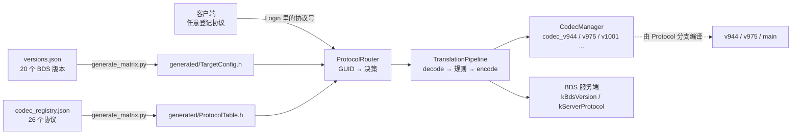

# CrossVersion — 开发者文档

面向用户的使用说明见仓库根目录的 [README.md](../README.md)。本文件保留工程内部的设计、构建与维护信息。

## 1. 调研结论与设计决策

| 仓库 | 实际情况 | 能不能改 |
| --- | --- | --- |
| [GlacieTeam/Glacie](https://github.com/GlacieTeam/Glacie) | 闭源宿主插件，仓库只有 README / `tooth.json` / 语言文件，二进制只在 Release，带联网激活码 | 不能。无源码，许可禁止整合与二次分发 |
| [SculkCatalystMC/Protocol](https://github.com/SculkCatalystMC/Protocol) | 开源协议层（MPL-2.0），是闭源付费库 ProtocolLib 的协议层源码 | 能。这是唯一可合法使用的部分 |

Glacie 运行时动态加载 `ProtocolLib.dll`（`LoadLibrary` + `GetProcAddress` + API version 校验），而 ProtocolLib 的 Release 说明直接写明协议层来自 Protocol。所以按字面「把两个仓库拼起来并改前面的组件」做不到：一个没源码，一个许可禁止整合。

采用的等价做法：不碰 Glacie / ProtocolLib 的任何二进制与授权机制，只用 MPL-2.0 的 Protocol 源码自建后端。关键设计：**协议差异不进插件本体**。每个 `codec_v<协议号>.dll` 由 Protocol 的对应分支编译，带独立 ABI 内联命名空间（`abi_v944` / `abi_v975` / `abi_v1001`），符号不冲突；主插件通过 `GetProcAddress("cv_get_api")` 取得 C ABI 函数表，运行时按协议号加载。新增协议版本不需要重编主插件。



## 2. 两条构建路径

| | **standalone（CI / 本地验证）** | **真机（xmake）** |
| --- | --- | --- |
| 入口 | `CMakeLists.txt` | `xmake.lua` |
| 编译器 | MSVC / GCC / Clang，C++20 | MSVC（VS2022）+ xmake ≥ 3.0.0 |
| 依赖 | 仓库内自带的 `nlohmann/json.hpp`，`compat/ll/api/Logger.h` 替代 `ll::Logger` | `levilamina <版本>` 包 + `nlohmann_json` |
| 链接 BDS 符号 | 否 | 是 |
| 网络接管 | 关闭（`hooks::install()` 返回 false） | 需补齐 `hookSymbols` 后接入 |
| 产物 | `CrossVersion.dll` / `.so`，可加载、可自检 | 可实际接管收发的插件 |
| 用途 | CI 验证 20 个版本的注入头、路由表、配置解析、翻译链都能编译链接并跑通断言 | 部署到真实 BDS |

CI 的 Windows runner 没有 BDS 的符号表和可链接 SDK，且 hook 符号每个版本都要逆向，硬跑真机路径只会 20 个 job 全红。所以加了 standalone 路径：用最小兼容头替代 `ll::Logger`，同一份 `src/` 源码不改一行，让核心逻辑真实编译、链接、跑 `ctest` 断言。两条路径共用 `src/CrossVersion.*`、`src/NetworkHooks.cpp`、`src/DllMain.cpp`；`DllMain.cpp` 里 `#include "ll/api/Logger.h"` 在 standalone 下解析到 `compat/`，在 xmake 下解析到 LeviLamina SDK。

## 3. GitHub Actions 流水线

`.github/workflows/build.yml` 共 5 个 job：

| Job | Runner | 作用 |
| --- | --- | --- |
| `prepare` | ubuntu | 从 `versions.json` 生成 20 项 matrix，产出 `dist/<版本>/` 的 manifest 与构建描述，跑静态自检 |
| `verify` | ubuntu | CMake 编译 `libCrossVersion.so` + `cv_verify`，跑路由自测 |
| `build-codecs` | windows-2022 | 尝试编译 Protocol 三个分支的 codec，**实验性**，`continue-on-error`，失败不阻塞 |
| `build` | windows-2022 × 20 | 逐版本注入 `TargetConfig.h` → CMake + VS2022 编译 → 组装 zip（artifact 名 `pkg-<BDS版本>`） |
| `release` | ubuntu | 打 `v*` tag 时汇总全部 zip 发布 Release |

触发方式：push 到 `main` 全量构建；PR 跑 prepare/verify/build；`workflow_dispatch` 可填 `versions` 只构建指定版本（如 `1.21.120,1.26.30`）；push `v*` tag 自动发 Release。

发布新版本：

```bash
git tag v0.1.0 && git push origin v0.1.0
```

commit message 含 `[skip ci]` 可跳过 push 触发的构建（如纯文档改动）。

## 4. 工程内部结构

| 路径 | 作用 |
| --- | --- |
| `versions.json` | 20 个目标 BDS 版本清单，驱动矩阵与注入头 |
| `codec_registry.json` | 26 个协议号 → Protocol 分支 / codec 状态 |
| `xmake.lua` | 真机构建（参数化 LeviLamina 版本与协议号） |
| `CMakeLists.txt` | standalone 构建（CI / 本地验证） |
| `compat/ll/api/Logger.h` | standalone 下的 `ll::Logger` 兼容实现 |
| `third_party/nlohmann/json.hpp` | 内置 JSON 库（v3.11.3，MIT），CI 无需外网依赖 |
| `tests/router_test.cpp` | 路由层自测，CI 的 `verify` job 执行 |
| `src/CodecApi.h` | 主插件与 codec DLL 的 C ABI 契约 |
| `src/CrossVersion.*` | 配置、codec 加载、路由、翻译链、插件生命周期 |
| `src/NetworkHooks.cpp` | BDS 网络接管注入点 |
| `src/DllMain.cpp` | 插件入口与日志 |
| `src/generated/` | 编译期注入的 `TargetConfig.h` / `ProtocolTable.h` |
| `codec/` | 按 Protocol 分支编译 `codec_v*.dll` |
| `scripts/generate_matrix.py` | 生成 CI 矩阵、每版本构建描述、注入头 |
| `scripts/verify_layout.py` | 静态自检（无需 Windows 工具链） |
| `dist/` | 每个版本的构建描述与覆盖度汇总（脚本生成） |

## 5. 本地开发

**Linux / macOS 验证（无需 Windows）**：

```bash
python3 scripts/generate_matrix.py --target 1.26.30
cmake -S . -B build -DCMAKE_BUILD_TYPE=Release -DCV_BUILD_TESTS=ON
cmake --build build -j4
ctest --test-dir build --output-on-failure
python3 scripts/verify_layout.py
```

**Windows standalone（CI 同款）**：

```powershell
python scripts/generate_matrix.py --target 1.26.60
cmake -S . -B build -G "Visual Studio 17 2022" -A x64 -DCV_BUILD_TESTS=OFF
cmake --build build --config Release
```

**Windows 真机（需要 LeviLamina SDK 与已补齐的 hook 符号）**：

```powershell
python scripts/generate_matrix.py --target 1.26.30
xmake f -y -p windows -a x64 -m release --ll_version=26.30.0 --cv_server_protocol=1001 --cv_bds_version=1.26.30
xmake -y
./scripts/build_codecs.ps1
```

注意：MSVC 下 `nlohmann/json.hpp` 需要 `/bigobj`（CMakeLists 已加）；自定义格式化函数命名为 `formatText` 而不是 `format`，避免与 `std::format` 的 ADL 二义性（C2668）。

## 6. 翻译规则引擎（v0.2.0 起）

数据流：`translation_rules.json` -> `TranslationRules::load()`（启动/reload 时解析，JSONC 带注释）-> `TranslationPipeline::hasRule()` 决定路由 -> `process()` 里按包应用策略。

- 规则按「源协议 -> 目标协议」逐对登记，`status=ready` 且两侧 codec 已加载才放行；
- 逐包策略：`deny`（丢弃并写日志）、`remap`（包 ID 重映射）、`pass`；planned 对一律拒绝；
- `strategy=header` 包头级（payload 原样），`strategy=model` 字段级（需两侧 codec 开 `CV_ENABLE_FULL_PACKET_MODEL`，目前仅 1001 分支支持）；
- 就绪规则：898 ⇄ 944（v898 codec 由 v944 分支派生，包结构同源）。

新增一条规则的步骤：在 `translation_rules.json` 加 planned 对 -> 补两侧协议定义与差异分析 -> 填 `deny`/`remap` -> 改 `status: ready` -> 跑 `verify_layout.py`（会校验规则对的协议号与 ready codec 一致）。

## 7. codec 构建的 MSVC 兼容补丁

`scripts/build_codecs.ps1` 在克隆 Protocol 分支后、configure 前打两类补丁（只改 vendor 目录，不动上游）：

1. `static_assert(mXxx.size() == ...)` -> `static_assert(decltype(mXxx)::size() == ...)`：通过对象名调用 static constexpr 的 `std::bitset::size()`，GCC/Clang 接受、MSVC 报 C2131；
2. `/FIcharconv` 强制前置包含：Protocol 的 CMake 把 sculk/reflection 钉在 v1.4.0，其 `string_utils.hpp` 缺 `<charconv>`（GCC 传递包含、MSVC 没有，C2039）。上游 Reflection 更新 tag 后此补丁自动失效。

## 8. 待补三件事

1. **BDS 网络 hook 符号与签名**（`versions.json` 的 `hookSymbols`）。每个版本需要收包点、发包点、Login 握手点三个符号；BDS 内部符号逐版本变化，是「按服务器版本单独构建」的根因。目前仅 1.26.60 填了一条示例。**hook 接线之前，就绪的翻译规则不会实际生效。**
2. **协议定义**。开源 Protocol 只有 `v944` / `v975` / `main(1001)` 三个分支；其余协议号是路由表占位，补齐一个约需 230 个包类，或从最近分支派生（参照 898 的 `fidelity: derived` 做法）。
3. **更多翻译规则对**。下一批：944 ⇄ 975 ⇄ 1001 的差异清单（相邻分支差异最小），再向 844 / 859 / 860 与 2168+ 段扩展。

各分支 API 有漂移（`v944`/`v975` 是 `readNoHeader`，`main` 是 `read`），`CryptoManager` 里硬编码了 `abi_v944`，参数化构建 codec 时要一起修。

## 9. 合规

- 使用 MPL-2.0 的 Protocol 源码：修改并分发时，被修改的覆盖文件继续以 MPL-2.0 发布，保留版权声明，提供对应源码。CI 的 MSVC 兼容补丁同样只作用于构建产物。
- 不打包、不链接、不分发 Glacie / ProtocolLib 的任何二进制，不复刻其授权机制。
- 内置 `nlohmann/json.hpp`（MIT，v3.11.3）。
- 自建代码可自由许可。

## 10. 路线图

1. 补齐 21 个版本的 `hookSymbols`，接通 `NetworkHooks.cpp`，让真机路径产出可接管网络的 DLL。
2. 登记 944 ⇄ 975 ⇄ 1001 的差异清单并把对应翻译对从 planned 转 ready（model 策略）。
3. 按 `1.21.11x ~ 1.21.12x`（844 / 859 / 860）补协议定义。
4. 补 `2168 ~ 2225` 段，跟进最新 BDS。
